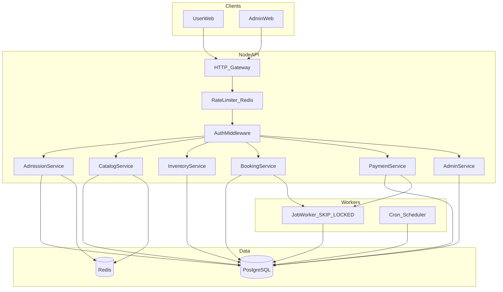
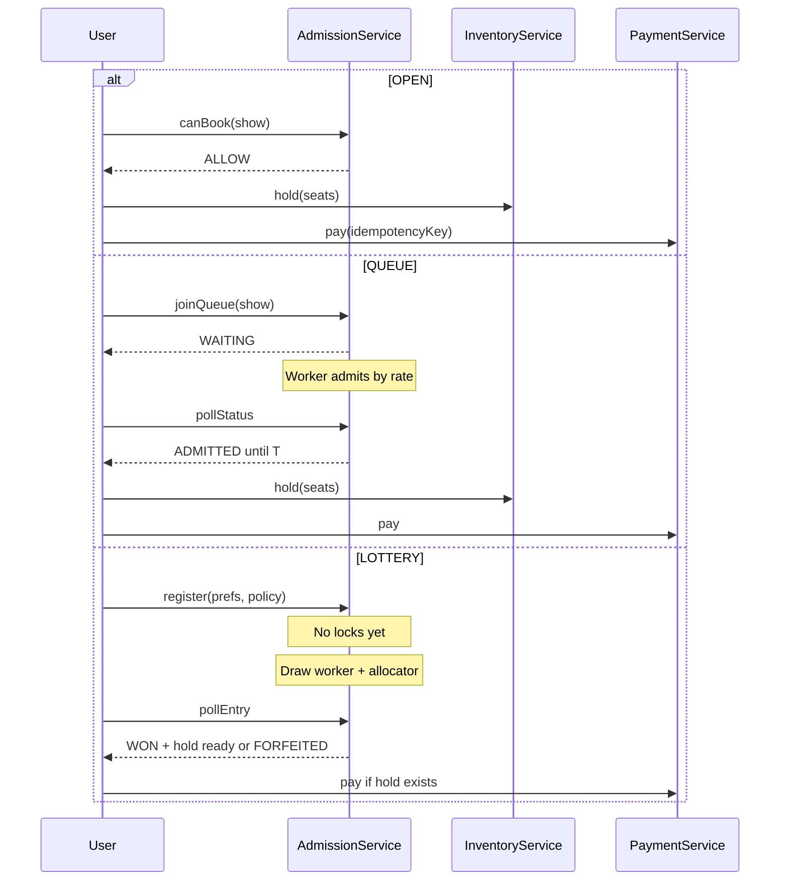
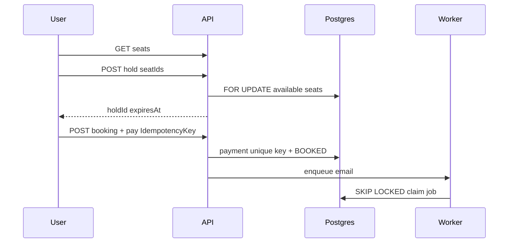

# BookMyShow — Low Level Design (`bms_main`)

**Stack:** Node.js + PostgreSQL + Redis  
**Scope:** User booking app + thin Admin API  
**Principles:** concurrency-safe inventory, extensible admission modes, idempotent payments, async jobs

Related: [CONTEXT.md](./CONTEXT.md), sibling lab `../race_condition`

---

## 1. Goals & non-goals

### Goals

- Correct seat inventory under concurrent booking (no double-book).
- Pluggable **admission** in front of the same booking engine: `OPEN`, `QUEUE`, `LOTTERY`.
- Lottery with **preferred seats** that are **not guaranteed** (IRCTC-style: try preferred; optional “only if preferred confirmed”).
- Thin admin to prove catalog extensibility (theaters, seat types, shows, admission config).
- Showcase: locking, rate limits, cache, idempotent payments, workers/cron/queues.

### Non-goals (v1)

- Full CMS / media pipeline / partner portals.
- Real SMS gateway or production payment PSP (use adapters + sandbox/mock).
- Mobile apps (API + simple web clients enough).

---

## 2. High-level architecture



**Invariant:** Admission decides *who may enter the booking path*. Inventory + Booking always own seats. Queue/Lottery never fork a second inventory engine.

---

## 3. Core domain concepts

### 3.1 Catalog (admin-managed)

| Entity | Role |
|---|---|
| `City` | Geography for discovery |
| `Movie` / `Event` | Content (`type`: movie \| concert \| other) |
| `Venue` (theater) | Physical place in a city |
| `Screen` | Auditorium in a venue |
| `SeatType` | GOLD / SILVER / VIP — pricing tier |
| `Seat` | Physical seat on a screen (`row`, `number`, `seat_type_id`) |
| `Show` | Event occurrence on a screen at `start_at` |
| `ShowPricing` | Price per `seat_type` for a show |

### 3.2 Inventory (per show)

`ShowSeat` is the **source of truth** for availability:

- Unique `(show_id, seat_id)`
- Status: `AVAILABLE | HELD | BOOKED`
- Hold metadata: `hold_id`, `held_until`, `version` (for optimistic paths where useful)

### 3.3 Admission (per show or event)

`Show.admission_mode`:

| Mode | Behavior |
|---|---|
| `OPEN` | Authenticated user may hold seats immediately (subject to rate limits). |
| `QUEUE` | User joins virtual queue; when granted a slot, they get a short booking window. |
| `LOTTERY` | User registers interest + preferred seats; draw assigns winners; winners get a booking window; seat prefs are soft. |

### 3.4 Booking & payment

- `Hold` → temporary claim on N seats  
- `Booking` → confirmed after successful payment  
- `Payment` → idempotent charge attempt  
- `LotteryEntry` → registration + preferences + draw outcome  

---

## 4. Database schema (LLD)

### 4.1 Catalog

```text
cities(id, name, slug UNIQUE, ...)
movies(id, title, type, duration_min, ...)
venues(id, city_id FK, name, address, ...)
screens(id, venue_id FK, name, ...)
seat_types(id, venue_id FK NULL, code, display_name)
  -- venue_id NULL = global defaults; else venue-specific types
seats(id, screen_id FK, seat_type_id FK, row_label, seat_number,
      UNIQUE(screen_id, row_label, seat_number))
shows(id, movie_id FK, screen_id FK, start_at, status,
      admission_mode CHECK IN ('OPEN','QUEUE','LOTTERY'),
      hold_ttl_seconds DEFAULT 600,
      booking_window_seconds DEFAULT 600,  -- after queue grant / lottery win
      UNIQUE(screen_id, start_at))
show_pricing(show_id FK, seat_type_id FK, amount_paise, PRIMARY KEY(show_id, seat_type_id))
```

**Indexes (examples):**

- `shows (movie_id, start_at)` and composite discovery `(city via venue join)` — validate with `EXPLAIN ANALYZE`
- Partial: `shows (start_at) WHERE status = 'SCHEDULED'`

### 4.2 Inventory & holds

```text
show_seats(
  id, show_id FK, seat_id FK,
  status CHECK IN ('AVAILABLE','HELD','BOOKED'),
  hold_id NULL, held_until NULL,
  version INT NOT NULL DEFAULT 0,
  UNIQUE(show_id, seat_id)
)
holds(
  id, show_id FK, user_id FK,
  status CHECK IN ('ACTIVE','EXPIRED','CONSUMED','CANCELLED'),
  expires_at, created_at
)
hold_seats(hold_id FK, show_seat_id FK, PRIMARY KEY(hold_id, show_seat_id))
```

### 4.3 Users, bookings, payments

```text
users(id, email UNIQUE, role CHECK IN ('USER','ADMIN'), ...)
bookings(
  id, user_id FK, show_id FK, hold_id FK NULL,
  status CHECK IN ('PENDING_PAYMENT','CONFIRMED','CANCELLED','FAILED'),
  total_paise, created_at
)
booking_seats(booking_id FK, show_seat_id FK, price_paise,
              PRIMARY KEY(booking_id, show_seat_id))
payments(
  id, booking_id FK, user_id FK,
  idempotency_key TEXT NOT NULL,
  amount_paise, status CHECK IN ('INIT','SUCCESS','FAILED'),
  provider_ref NULL, request_hash, response_json,
  UNIQUE(user_id, idempotency_key)
)
```

### 4.4 Queue admission

```text
queue_sessions(
  id, show_id FK, user_id FK,
  status CHECK IN ('WAITING','ADMITTED','EXPIRED','CANCELLED'),
  position BIGINT,           -- or score in Redis ZSET
  admitted_until NULL,       -- booking window end
  created_at,
  UNIQUE(show_id, user_id)   -- one active intent per user/show (soft rule)
)
```

**Runtime:** Redis `ZSET queue:show:{showId}` for ordering + rate of admission; Postgres for durability/audit. Worker admits `N` users/minute into `ADMITTED` with `admitted_until`.

### 4.5 Lottery admission (IRCTC-style preferences)

```text
lottery_rounds(
  id, show_id FK UNIQUE,   -- one active round per show in v1
  status CHECK IN ('OPEN','CLOSED','DRAWN','SETTLED'),
  registration_opens_at, registration_closes_at,
  draw_at, winners_count,  -- how many booking windows to grant
  created_at
)
lottery_entries(
  id, round_id FK, user_id FK,
  status CHECK IN ('REGISTERED','WON','LOST','FORFEITED','BOOKED'),
  seat_count INT NOT NULL,                 -- how many seats requested
  preference_policy CHECK IN (
    'STRICT_PREFERRED',  -- book only if all preferred seats allocatable (IRCTC "only if confirmed")
    'PREFERRED_ELSE_ANY' -- try preferred; else any available seats
  ),
  preferred_seat_ids JSONB NOT NULL,       -- ordered preference list (soft)
  allocated_show_seat_ids JSONB NULL,      -- filled after win+allocation attempt
  booking_window_until NULL,
  UNIQUE(round_id, user_id)
)
```

**Semantics:**

1. User registers while round is `OPEN`: stores preferred seats + policy. **No seat locks at registration.** Preferences are advisory.
2. At `draw_at`, worker closes round, randomly selects `winners_count` entries (fair shuffle / `TABLESAMPLE` / Fisher–Yates on ids), marks `WON`/`LOST`.
3. For each winner, **allocator** runs under inventory locks:
   - Try preferred seats in order (atomic claim).
   - If `STRICT_PREFERRED` and cannot get full preferred set → mark `FORFEITED` (or `LOST` with reason); **do not** book partial.
   - If `PREFERRED_ELSE_ANY` → fill remaining from available seats (deterministic order, e.g. by seat id).
4. Successful allocation creates an `ACTIVE` hold + sets `booking_window_until`. User then pays like OPEN mode.
5. Unpaid holds expire via cron → seats return to `AVAILABLE`; entry may become `FORFEITED`.

This mirrors IRCTC: selecting seats/berths does not guarantee them; “book only if confirmed” maps to `STRICT_PREFERRED`.

### 4.6 Jobs

```text
jobs(
  id, task TEXT, payload JSONB,
  status CHECK IN ('pending','running','done','failed','dead'),
  attempts INT, run_at TIMESTAMPTZ, last_error TEXT,
  created_at
)
-- claim: SELECT ... FOR UPDATE SKIP LOCKED WHERE status='pending' AND run_at <= now()
```

---

## 5. Seat locking & concurrency (booking engine)

All modes eventually call the same inventory primitives.

### 5.1 Hold seats (atomic)

Inside one transaction:

```text
1. Assert admission allows this user for this show (OPEN | QUEUE admitted | LOTTERY won+window).
2. SELECT show_seats WHERE id IN (...) AND show_id = $show
     FOR UPDATE  -- or lock in stable id order to avoid deadlocks
3. Assert every row status = AVAILABLE
     (and held_until IS NULL OR held_until < now() if you reclaim inline)
4. UPDATE show_seats
     SET status='HELD', hold_id=$hold, held_until=now()+ttl, version=version+1
5. INSERT holds + hold_seats
6. COMMIT
```

**Alternate (single-statement style):**  
`UPDATE ... WHERE id IN (...) AND status='AVAILABLE' RETURNING *` and require `rowCount === N`; else rollback. Same idea as `atomic` in `race_condition`.

### 5.2 Confirm after payment

```text
1. Idempotent payment success (see §7)
2. In tx: lock hold + show_seats FOR UPDATE
3. Assert hold ACTIVE and not expired; seats still HELD for this hold_id
4. UPDATE show_seats SET status='BOOKED'
5. UPDATE hold CONSUMED; booking CONFIRMED
6. Enqueue notify_ticket job
```

### 5.3 Expire holds (cron / worker)

```text
UPDATE show_seats SET status='AVAILABLE', hold_id=NULL, held_until=NULL
WHERE status='HELD' AND held_until < now()
-- plus mark holds EXPIRED
```

Run periodically; also reclaim opportunistically on next hold attempt.

### 5.4 What we deliberately avoid

- Naive read stock in app → sleep → write absolute value (lost update).
- Optimistic version-only on hot shows without a fallback (retry storms — see race lab).
- Caching live seat maps as long-lived Redis values without invalidation.

---

## 6. Admission strategies (extensibility)



### Interface (Node module)

```js
// admission/AdmissionStrategy.js
// canEnterBooking({ userId, showId }) -> { allow, reason, windowUntil? }
// Optional mode-specific APIs: joinQueue, registerLottery, ...
```

| Strategy class | Responsibilities |
|---|---|
| `OpenAdmission` | Always allow if show onsale |
| `QueueAdmission` | Join/poll; allow only if `ADMITTED && now < admitted_until` |
| `LotteryAdmission` | Register/poll; allow pay only if hold from allocator still active |

Admin sets `shows.admission_mode` (+ lottery round / queue config). **Adding a new mode = new strategy class + config**, not a new seat table.

---

## 7. Payments (idempotency)

```text
POST /bookings/:id/pay
Header: Idempotency-Key: <uuid>
```

Flow:

1. Hash body; `INSERT payments (user_id, idempotency_key, ...)` with **UNIQUE** constraint.
2. Conflict:
   - same key + same hash → return stored response
   - same key + different hash → `422`
   - status `INIT` → `409` in-progress
3. Call provider adapter (`MockProvider` / Razorpay later) with same idempotency key.
4. On success → confirm booking (§5.2) in same logical flow (DB tx after provider success; handle crash with provider reconciliation job).

---

## 8. Caching, rate limits, pooling

| Concern | Design |
|---|---|
| Cache-aside | Redis for city/movie/show metadata; invalidate on admin writes; TTL + jitter |
| Seat map | Short TTL (e.g. 1–2s) or no cache; always re-check on hold |
| Rate limit | Redis token bucket: search, join queue, lottery register, hold, pay |
| Stampede | Lock/singleflight on hot metadata keys |
| DB pool | Modest `pg` pool per API instance; PgBouncer in front when scaling out |
| Queries | No N+1 on show listings — join/include venue + pricing in bulk |

---

## 9. Workers & cron

| Task | Trigger | Notes |
|---|---|---|
| `expire_holds` | Cron every 30s | Free HELD seats past TTL |
| `admit_queue` | Cron / loop | Move WAITING → ADMITTED by configured rate |
| `lottery_close_and_draw` | At `draw_at` | Mark winners |
| `lottery_allocate` | After draw | Hold seats per policy; may FORFEIT strict failures |
| `send_ticket_email` | After CONFIRMED | SKIP LOCKED job |
| `reconcile_payment` | Periodic | Match provider vs local INIT rows |

Job claim pattern: `FOR UPDATE SKIP LOCKED` + exponential backoff + dead letter (from CONTEXT).

---

## 10. API surface (LLD)

### 10.1 User — catalog & booking

```text
GET  /cities
GET  /cities/:id/movies
GET  /movies/:id/shows?cityId=
GET  /shows/:id
GET  /shows/:id/seats                 -- map with statuses (best-effort freshness)

POST /shows/:id/holds                 -- OPEN or admitted QUEUE; body: seatIds[]
POST /holds/:id/cancel
POST /bookings                        -- from holdId
POST /bookings/:id/pay                -- Idempotency-Key required
GET  /bookings/:id
GET  /me/bookings
```

### 10.2 User — queue

```text
POST /shows/:id/queue                 -- join
GET  /shows/:id/queue/me              -- position / admitted_until
```

### 10.3 User — lottery

```text
POST /shows/:id/lottery/entries
     body: {
       seatCount,
       preferredSeatIds[],            -- not guaranteed
       preferencePolicy: STRICT_PREFERRED | PREFERRED_ELSE_ANY
     }
GET  /shows/:id/lottery/entries/me    -- REGISTERED|WON|LOST|FORFEITED|BOOKED
```

### 10.4 Admin (thin)

```text
POST   /admin/cities | venues | screens | seat-types | seats | movies
POST   /admin/shows
PATCH  /admin/shows/:id               -- pricing, admission_mode, status
POST   /admin/shows/:id/lottery-rounds
PATCH  /admin/lottery-rounds/:id      -- schedule, winners_count
POST   /admin/shows/:id/queue-config  -- admit rate, max waiting
```

Auth: `role=ADMIN` for `/admin/*`.

---

## 11. Module layout (Node)

```text
bms_main/
  CONTEXT.md
  LLD.md
  package.json
  src/
    app.js                 -- HTTP server / router
    config.js
    db/
      pool.js
      migrate.js
    modules/
      catalog/
      inventory/           -- hold, release, confirm (locking here)
      admission/
        OpenStrategy.js
        QueueStrategy.js
        LotteryStrategy.js
        index.js           -- factory by show.admission_mode
      booking/
      payment/
        providers/MockProvider.js
      admin/
      jobs/
        worker.js
        handlers/
    middleware/
      auth.js
      rateLimit.js
  scripts/
    seed.js
    bench-hold.js          -- concurrent hold stress (like race_condition)
```

---

## 12. End-to-end flows

### 12.1 OPEN movie booking



### 12.2 QUEUE concert

1. Admin sets `admission_mode=QUEUE` + admit rate.  
2. Users `joinQueue`; Redis ZSET orders them.  
3. `admit_queue` grants windows.  
4. Inside window → same hold → pay as OPEN.  
5. Window miss → back of queue or expired (product rule: expire).

### 12.3 LOTTERY + soft preferences

1. Admin creates lottery round (`winners_count`, open/close/draw times).  
2. Users register with `preferredSeatIds` + `STRICT_PREFERRED` or `PREFERRED_ELSE_ANY`. **No locks.**  
3. Draw marks winners.  
4. Allocator locks inventory; tries preferences; may `FORFEIT` if strict fails.  
5. Winner pays within `booking_window_until`.  
6. Losers / forfeits get clear status for UI.

---

## 13. Extensibility checklist (what “B” proves)

| Extension | How |
|---|---|
| New theater / screen / seat type / show | Admin APIs + data; no code change |
| New admission mode | New `AdmissionStrategy` + enum value |
| New payment provider | New provider adapter behind `PaymentService` |
| New notification channel | New job handler |
| Lottery vs queue for concerts | Config on `Show`, not separate booking codebase |

---

## 14. Correctness & demo plan

1. **Bench:** `bench-hold.js` — 100 concurrent holds on 10 seats → exactly 10 winners (reuse race lab lessons).  
2. **Lottery strict:** two winners prefer same seats + `STRICT_PREFERRED` → one gets hold, other `FORFEITED` (or second gets nothing), never double-book.  
3. **Idempotency:** replay pay with same key → one charge.  
4. **Expire:** held seats return after TTL.  
5. **Admin:** create venue → seats → show → switch mode OPEN/QUEUE/LOTTERY without redeploying inventory code.

---

## 15. Decisions locked

| Topic | Decision |
|---|---|
| Scope | User + thin Admin |
| Stack | Node.js, PostgreSQL, Redis |
| Admission | OPEN + QUEUE + LOTTERY |
| Lottery seats | Preferences only; not guaranteed |
| IRCTC analog | `STRICT_PREFERRED` = book only if preferred seats can be fully allocated |
| Inventory | Single engine; `show_seats` + row locks / conditional UPDATE |
| Payments | Idempotency keys required |
| Jobs | Postgres `SKIP LOCKED` + cron |
| Cache | Metadata yes; live seats minimal/short TTL |

---

## 16. Implementation phases (after LLD approval)

1. Schema + migrations + seed + catalog read APIs  
2. Inventory hold/confirm + concurrent bench  
3. Payments + idempotency + booking  
4. Admin CRUD  
5. QUEUE admission + Redis  
6. LOTTERY register/draw/allocate + preference policies  
7. Workers (expire, email) + rate limit + cache  

**Status:** LLD complete; application code not started.
